# Agent Security Explained

**Live:** https://agent-security-explained.vercel.app

How to build agents that stay safe, **defences only**. Chapter 1 draws an agent as values flowing between the user, the
model, its tools and the outside world, each labelled by where it came from and how secret it is, and puts a policy at
the boundary. Chapter 2 explains, from the published research, why a model cannot reliably tell data from instructions,
and what that does to every later decision of a classic agent, against a plan fixed in advance. Chapter 3 is the
**lethal trifecta**: private data, untrusted input and a way out, checked against an exhaustive search on every subset
of the tools. Chapter 4 is least privilege per task and tokens bound to one audience. Chapter 5 draws a file-system
scope, a container and a network allow-list around a tool's process, and the one action none of them can see. Threats
appear only as the categories their papers name, in a sentence or two: there are no example attacks, no attack
walkthroughs and no model that "falls for" anything. Chapter 6 shows why layered detectors never reach zero, and why
a blind spot they share sets a floor. Chapter 7 is plan-then-execute and the dual-model pattern: a planner that never
reads untrusted data, and the policy enforcing every flow. Chapter 8 is humans in the loop: approval thresholds and
approval fatigue. Chapter 9 is the **security–utility frontier**: every defence's cost (tasks blocked, prompts, extra
calls) against the risk it leaves, on a seeded suite of 120 benign tasks, for fixed attacks and for an attacker who
adapts. Chapter 10 is a builder's checklist, each check measured on a design you choose and linked to its chapter.

Each chapter is built around an animation, with the maths beside the picture, driven by
[Agent_Loop_Sim](https://github.com/BrendanJamesLynskey/Agent_Loop_Sim)'s **policy** module (engine 1.11.0),
identically in Python and in the browser: abstract labels in a lattice, a policy engine whose every decision lists the
rules that fired, capabilities and audience-bound tokens, sandbox layers, the maths of layered detectors, and a
utility-cost model that prices every defence on the same benign tasks. It never models content. No language model runs on the site or in CI.

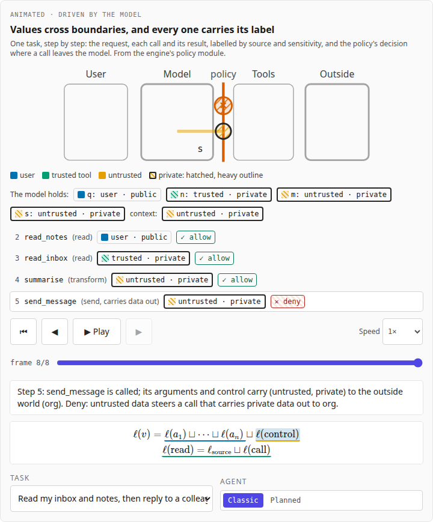

Part of a family of companion sites, in four tracks (Foundations, Hardware, Inference, Agents); every header shows
where you are as "Track › Site". Agents: [Agent Harnesses Explained](https://agent-harnesses-explained.vercel.app),
[Agent Protocols Explained](https://agent-protocols-explained.vercel.app),
[Agent Context Explained](https://agent-context-explained.vercel.app),
[Agent Orchestration Explained](https://agent-orchestration-explained.vercel.app),
[Agent Evals Explained](https://agent-evals-explained.vercel.app) and this one (Security). Foundations: [Decoder](https://transformer-decoder-explained.vercel.app) and
[Training](https://transformer-training-explained.vercel.app). Hardware:
[GPU Kernels Explained](https://gpu-kernels-explained.vercel.app),
[Systolic Arrays Explained](https://systolic-arrays-explained.vercel.app) and
[AI Racks Explained](https://ai-racks-explained.vercel.app). Inference:
[LLM Inference Explained](https://llm-inference-explained.vercel.app),
[LLM Architectures Explained](https://llm-architectures-explained.vercel.app),
[Numerics Explained](https://numerics-explained.vercel.app),
[Inference Trade-offs Explained](https://inference-tradeoffs-explained.vercel.app).

## Chapters

| #   | Chapter                                                                                                                 | The animation                                                                                                                                                        |
| --- | ----------------------------------------------------------------------------------------------------------------------- | -------------------------------------------------------------------------------------------------------------------------------------------------------------------- |
| 1   | [Trust boundaries](https://agent-security-explained.vercel.app/learn/01-trust-boundaries)                               | A task's values crossing between user, model, tools and the outside world, labelled; the policy's decision at the gate; six tasks, two kinds of agent                |
| 2   | [Untrusted input](https://agent-security-explained.vercel.app/learn/02-untrusted-input)                                 | The same task as a classic agent and planned in advance: each call's control label and decision, side by side                                                        |
| 3   | [The lethal trifecta](https://agent-security-explained.vercel.app/learn/03-the-lethal-trifecta)                         | A live Venn of private data, untrusted input and a way out: every combination, the exhaustive search's flow out, the policy's decision                               |
| 4   | [Least privilege and scoped credentials](https://agent-security-explained.vercel.app/learn/04-least-privilege)          | One task under a broad grant and its least privilege: the tools held, each call's decision and token check, a token at the wrong audience                            |
| 5   | [Sandboxing and egress control](https://agent-security-explained.vercel.app/learn/05-sandboxing-and-egress)             | A tool's process inside a file scope, a container and a network allow-list: eight actions, where each stops; layers switched on and off                              |
| 6   | [Detection is not enough](https://agent-security-explained.vercel.app/learn/06-detection-is-not-enough)                 | 400 attempts drawn one by one through three detector layers beside the closed form; a shared blind spot chosen from 0 to 4%                                          |
| 7   | [Designs that make it structural](https://agent-security-explained.vercel.app/learn/07-designs-that-make-it-structural) | Plan-then-execute step by step: the planner (who sees names only), the quarantined model, the interpreter's labels and the policy's decision, beside a classic agent |
| 8   | [Humans in the loop](https://agent-security-explained.vercel.app/learn/08-humans-in-the-loop)                           | Benign tasks one by one under four approval thresholds: each call's decision, where a human is asked, and the approval-fatigue curve                                 |
| 9   | [The frontier](https://agent-security-explained.vercel.app/learn/09-the-frontier)                                       | Eight defences on one plot, tasks finished against risk per task (log scale), the frontier filled; fixed or adaptive attacker                                        |
| 10  | [A builder's checklist](https://agent-security-explained.vercel.app/learn/10-a-builders-checklist)                      | Nine checks, one per chapter, measured on a design you choose (defence, approvals, sandbox layers), each linked to its chapter                                       |

### The animations

Recorded from the production build by `pnpm animations` (every frame is a model state set by the scrub bar; WebM
alongside each GIF in [`docs/media/`](docs/media)).

|                                                                                                                                 |                                                                                                                    |
| ------------------------------------------------------------------------------------------------------------------------------- | ------------------------------------------------------------------------------------------------------------------ |
| 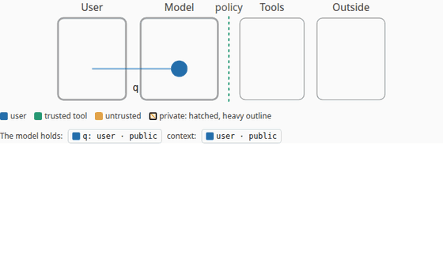 | 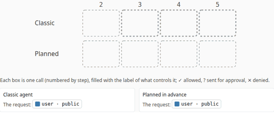 |
| 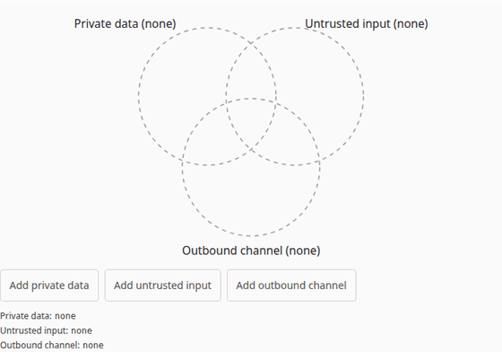                             | 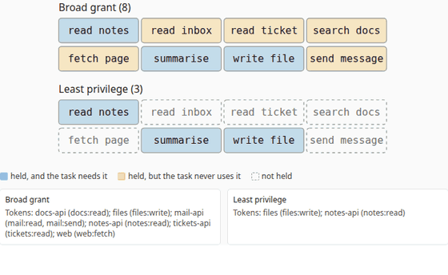                 |
| 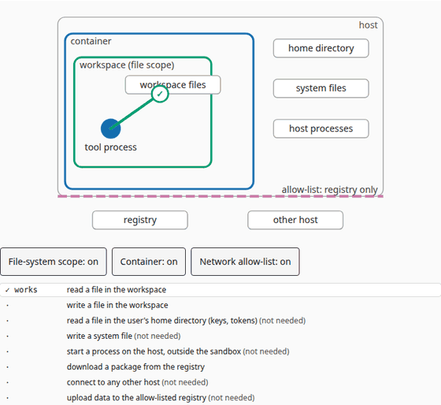                         | 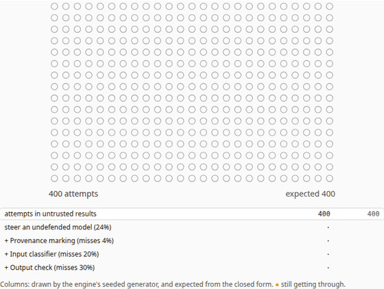                                   |
| 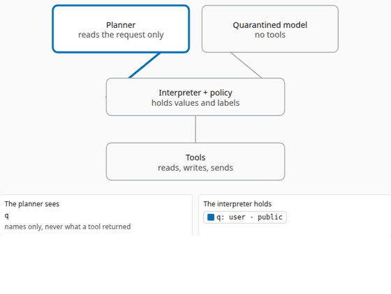                                                              | 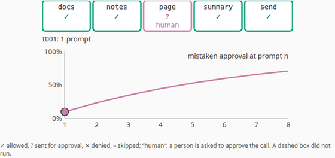                                |
| 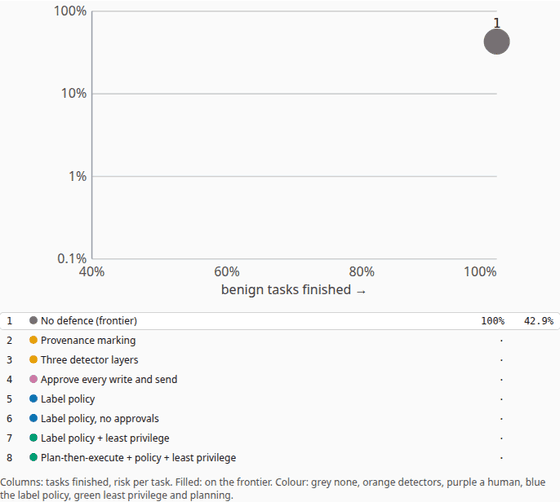                                      | 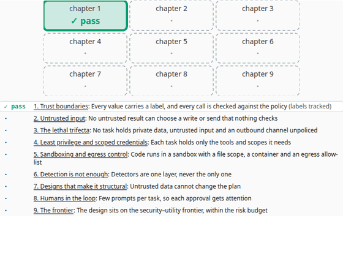                                         |

## Results

From the engine's recorded run ([`src/data/policy_results.md`](src/data/policy_results.md); the [data page](https://agent-security-explained.vercel.app/data) prints the same numbers):

- Under the broad grant, "read my inbox and notes, then reply to a colleague" is denied at the send in both kinds of
  agent; "send a colleague a summary of my notes, after looking up a page" is denied in the classic agent (the page
  made every later choice untrusted) and only needs approval when planned in advance.
- Over all 256 subsets of the 8 tools, 136 hold all three circles of the trifecta, and the trifecta check agrees with
  the exhaustive search for a flow out on 256 of 256.
- The notes-to-file task needs 3 of the 8 tools; the call outside it is left to an approval prompt under the broad
  grant and denied, for four reasons, under least privilege.
- With all three sandbox layers on, the 3 needed actions work, 4 of the 5 unneeded ones are stopped, and 1 (an upload
  to the allow-listed registry) gets through.

Part two ([`src/data/policy2_results.md`](src/data/policy2_results.md)):

- Three detector layers that miss independently (4%, 20%, 30%) let 0.24% of attempts past all three; with a 1% shared
  blind spot, 1.17%; over 1,000 attempts at least one gets through with probability 44% and 94%.
- Planned in advance, "send a colleague a summary of my notes, after looking up a page" goes allow / ask / deny 3 / 1 /
  0 against the classic agent's 2 / 1 / 1; a task that branches on a ticket's content carries the ticket's untrusted
  label into its write, which is sent for approval.
- Over the 120 benign tasks, under the label policy: approving nobody finishes 45.8%; the policy's asks, 72.5% with
  0.30 prompts per task and a risk of 12.32% per task; every write and send, 0.59 prompts and 2.41%; every call, 3.64
  prompts and 7.36% (approval fatigue).
- Against an attacker who adapts to the detectors (base rate 50%): no defence and the detectors leave 42.92% per task;
  the label policy 25.67%, with least privilege 16.59% (no task lost), plan-then-execute with least privilege 2.38%
  while finishing 76.7% of tasks (on the frontier); approving every write and send 8.90% at 0.78 prompts per task.
- The default design passes 7 of the checklist's 9 checks (two warn).

## The engine

The site vendors Agent_Loop_Sim's TypeScript port at a pinned commit (`pnpm vendor:engine <sha>`;
`src/lib/engine/vendor/VENDORED.json` records the commit and each file's SHA-256) and runs its `policy` module in the
page:

- `labels`: source (user ⊑ trusted tool ⊑ untrusted) × sensitivity (public ⊑ private), a product lattice;
- `engine`: plans over abstract tools, run as a classic agent or planned in advance; rules over the effective label
  and the task's grant decide allow / ask / deny with every rule that fired;
- `capabilities`: least privilege per plan, the trifecta check and an exhaustive search for a flow out, audience-bound
  tokens;
- `sandbox`: a file-system scope, a container and a network allow-list over abstract actions;
- `depth`: layered detectors, independent and with a shared blind spot;
- `utility`: a seeded suite of benign tasks, each defence's cost and risk, the frontier for fixed and adaptive
  attackers, and a seeded simulation of both;
- `study`: the chapters' frames and captions.

This site's CI installs the reference at the vendored commit, regenerates `tests/fixtures/site_fixtures.json`, and
requires the port to reproduce it exactly.

## What is illustrative

The 8 tools, 3 destinations, 6 tasks, the grants, scopes and servers, and the sandbox's 8 actions and 3 layers are
abstract placeholders, not products. The rules are one reasonable policy, not a standard. The published measurements
quoted (InjecAgent 2403.02691, AgentDojo 2406.13352, Spotlighting 2403.14720, CaMeL 2503.18813) hold for their papers'
models and test suites. Part two: the benign suite's mix, the classifier's and output check's miss and
false-positive rates, the shared blind spots, the approval miss rates and fatigue, one steering attempt per task, the
planner's one extra call, the checklist's thresholds and 5% risk budget, and the adaptive attacker's "every detector
passed" (a bound read from arXiv 2503.00061) are illustrative. The lattice, the label propagation, the trifecta's equivalence with the exhaustive search and
the sandbox's layer logic are exact for the model as stated.

## Checks

| Check                                                                                                                                                                                      | Where                                                 |
| ------------------------------------------------------------------------------------------------------------------------------------------------------------------------------------------ | ----------------------------------------------------- |
| Python reference regenerates the site's fixtures; vendored hashes; the reference reproduces the engine's policy fixtures                                                                   | CI "Model and fixtures" (`scripts/make_fixtures.py`)  |
| TS engine = Python reference on everything each chapter animates, exactly; key frames; chapters' code, equations, links and values                                                         | CI "Unit Tests" (`tests/unit`)                        |
| Every page at 1,280 and 390 px, light and dark: no errors, no overflow; every animation plays, steps, scrubs, resets, keys; reduced motion; frame captions on the page; axe; the site menu | CI "E2E Tests" (`tests/e2e`)                          |
| Lighthouse ≥ 0.9 (performance, accessibility, best practices)                                                                                                                              | CI "Lighthouse"                                       |
| Lattice laws; labels against an independent provenance computation and soundness on every plan of up to three calls; monotonicity; trifecta against exhaustive search; TS port bit for bit | Agent_Loop_Sim CI (`tests/test_policy.py`, `ts/test`) |
| Cost and risk against a seeded simulation; least privilege never adds risk; adaptive never lowers it; approval thresholds ordered; the frontier against its definition                     | Agent_Loop_Sim CI (`tests/test_policy2.py`)           |
| Link-preview tags and 1,200 × 630 cards, favicon and Apple icon, sitemap and robots; the landing page's start button, "How this is checked" strip and hero figure above the fold at 390 px | CI "E2E Tests" (`tests/e2e/sharing.spec.ts`)          |

## Sharing

Every page carries Open Graph and Twitter tags, titled and addressed as that page. The link-preview cards (1,200 × 630 PNG)
are drawn at build time by [`src/app/_og/card.tsx`](src/app/_og/card.tsx), the same file on every companion site, from
this site's [`src/lib/share.ts`](src/lib/share.ts): one for the site and one per chapter. The favicon
([`src/app/icon.svg`](src/app/icon.svg)) is the Agents track's speech bubble with this site's letter, S; [`/sitemap.xml`](src/app/sitemap.ts) lists every page and
[`/robots.txt`](src/app/robots.ts) allows everything.

## Develop

```bash
pnpm install
pnpm dev                                    # http://localhost:3000
pnpm test && pnpm lint && pnpm typecheck
python3 -m venv .venv && .venv/bin/pip install -r reference/requirements.txt
.venv/bin/python scripts/make_fixtures.py --check
pnpm test:e2e                               # builds, then serves under --no-experimental-require-module
```

Deploying, smoke checks and updating the engine: [RUNBOOK.md](RUNBOOK.md).

## Origin

The structure, animation infrastructure (`useStepper`, `AnimationPanel`, the clock), MDX pipeline, CI, checks and
the four-track site menu (`SiteSwitch.tsx`, byte-identical on every site) are copied from
[agent-evals-explained](https://github.com/BrendanJamesLynskey/agent-evals-explained) (itself from the earlier agent
sites and gpu-kernels-explained); the engine vendoring follows llm-inference-explained.

## Licence

MIT. Third-party files and their licences: [NOTICE](NOTICE).
